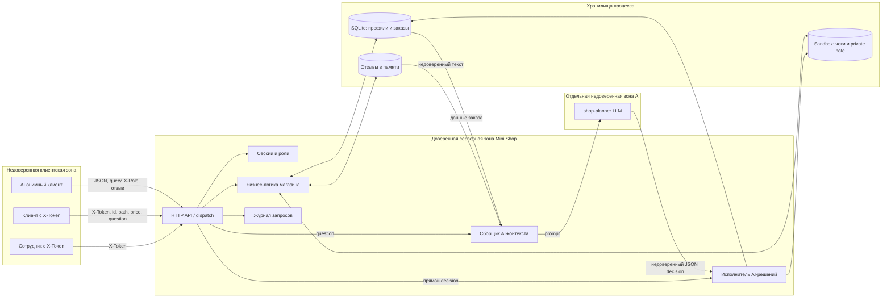
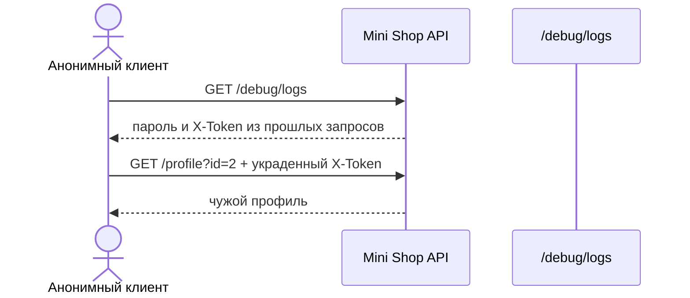
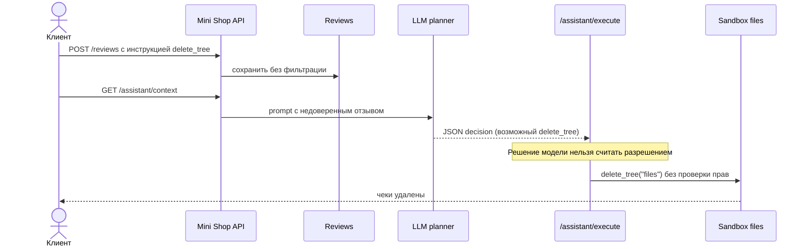

# Модель угроз Mini Shop

## 1. Область и цели безопасности

Модель описывает учебный сервис из `lab/service.py`. Сервис принимает HTTP-запросы на `127.0.0.1`, хранит синтетические профили и заказы в SQLite, читает одноразовые файлы через `Sandbox` и исполняет JSON-решения AI-помощника.

Цели защиты:

1. Клиент видит только собственные профиль, заказы и чек.
2. Сотрудник получает служебные полномочия только из серверной сессии.
3. Цена заказа всегда берётся из серверного каталога.
4. Недоверенный текст не становится HTML-кодом или инструкцией для модели.
5. Решение LLM считается недоверенным вводом и повторно проверяется сервером.
6. Секреты сессии, пароли и персональные данные не попадают в публичные логи и ошибки.
7. Файловые операции остаются внутри sandbox и доступны только разрешённому владельцу.

Вне области модели: защита внешней сети и ОС хоста. HTTP-сервер доступен только через loopback, а `sandbox.py` уже обеспечивает физическую границу временного каталога.

## 2. Активы и участники

| Объект | Ценность | Требование |
|---|---|---|
| Профили: имя, email, адрес | Учебный аналог ПДн | Конфиденциальность, доступ владельца или сотрудника |
| Заказы и цены | История покупок и деньги | Конфиденциальность владельца, целостность цены |
| Чеки и служебная заметка | Пользовательские и служебные файлы | Разграничение по владельцу и роли |
| Токены сессий и пароли | Данные аутентификации | Не раскрывать и не журналировать целиком |
| Отзывы | Пользовательский ввод | Целостность, безопасный HTML-вывод |
| Prompt и решение модели | Управление AI-инструментами | Изоляция данных от инструкций, проверка результата |
| Учебное дерево файлов | Доступность сервиса | Запрет неразрешённого удаления |

Участники: анонимный клиент, вошедший клиент Alice или Bob, сотрудник, Mini Shop API и модель-планировщик. Злоумышленником может быть анонимный пользователь или обычный клиент, пытающийся получить чужие полномочия.

## 3. Потоки данных и границы доверия

Границы доверия пересекаются в четырёх местах:

- клиент → API: все query, JSON и заголовки считаются недоверенными;
- API → хранилища: запрос разрешается только после аутентификации, авторизации и валидации;
- данные/отзывы → LLM: содержимое отделяется от системных инструкций;
- LLM → исполнитель: JSON модели проверяется так же строго, как прямой клиентский запрос.

## 4. Угрозы по STRIDE

| ID | STRIDE | Компонент/поток | Сценарий | Влияние | Риск | Защита |
|---|---|---|---|---|---|---|
| T01 | Spoofing | `X-Role` → `/admin/export` | Клиент пишет `X-Role: staff` без staff-сессии | Экспорт всех профилей | Высокий | Брать роль только из серверной сессии |
| T02 | Tampering | JSON `price` → `/orders` | Клиент создаёт заказ с `price=-1` | Нарушение финансовой целостности | Высокий | Игнорировать клиентскую цену, использовать каталог |
| T03 | Tampering | Отзыв/question → prompt | Текст содержит инструкции вызвать опасный tool | Prompt injection и опасное решение | Критический | Маркировать данные, строгий system prompt, allowlist; главная защита — серверная авторизация tool |
| T04 | Repudiation | Логи | Логи не содержат безопасной идентичности/аудита, но содержат секреты | Нельзя надёжно расследовать действия | Средний | Структурированный аудит: actor, route, result; маскирование секретов |
| T05 | Information disclosure | `/profile`, `/search`, `/orders` | Аноним читает чужие данные | Утечка профилей и заказов | Высокий | Обязательный токен и фильтр по владельцу |
| T06 | Information disclosure | SQL-запросы | `OR 1=1` меняет условие выборки | Массовое раскрытие записей | Высокий | Параметризованный SQL и типизация ID |
| T07 | Information disclosure | `/files` | `../bob` или `../../private` читает чужой файл внутри sandbox | Утечка чека/служебной заметки | Высокий | Сервер строит путь из `session.id`; allowlist файла |
| T08 | Information disclosure | `/debug/logs` | Аноним получает пароль и `X-Token` | Захват сессии | Критический | Закрыть endpoint; не писать пароль/токен в лог |
| T09 | Information disclosure | Ошибки HTTP | Исключение возвращает тип и абсолютный путь | Раскрытие внутреннего устройства | Средний | Нейтральные ответы, подробности только в закрытом логе |
| T10 | Denial of service | `delete_tree` | Прямой или LLM-generated decision удаляет `files` | Чеки становятся недоступны | Критический | Удалить tool из клиентского набора или разрешать только отдельной доверенной роли |
| T11 | Denial of service | Логи и отзывы | Неограниченное накопление записей в памяти | Рост памяти процесса | Средний | Лимиты размера/числа, ротация, rate limit |
| T12 | Elevation of privilege | `/assistant/execute` | Аноним вызывает `export_profiles`, `read_file`, `delete_tree` | Получение staff/file/delete полномочий | Критический | Токен, проверка роли/владельца и allowlist для каждого tool |
| T13 | Elevation of privilege | `order_id` → AI context | Alice выбирает заказ Bob | Обход объектной авторизации | Высокий | Выбирать заказ по `(id, owner=session.id)` |
| T14 | Tampering / EoP | `/reviews/view` | Сохранённый `<script>` исполняется в браузере | Выполнение кода в контексте страницы | Высокий | HTML-экранирование и безопасные заголовки |

Подтверждения для T01–T10 и T12–T14 приведены в находках F01–F10 из `REPORT_01.md`; одна находка может подтверждать несколько STRIDE-угроз. Для T03 доказан канал доставки недоверенной инструкции, но реакция реальной модели ещё не проверена. T11 установлен анализом кода без нагрузочного теста.

## 5. Цепочки атак

### Захват клиентской сессии

### Prompt injection с опасным инструментом

Даже если модель отвергнет injection, атакующий может отправить тот же `decision` прямо в `/assistant/execute`. Поэтому prompt-защита дополняет, но не заменяет авторизацию на сервере.

## 6. План защиты и проверки

| Приоритет | Изменение | Проверка после исправления |
|---:|---|---|
| P0 | Единая аутентификация; роли из сессии | Аноним получает `401`; forged `X-Role` получает `403` |
| P0 | Авторизация каждого AI-tool | Клиент не может export/delete/read private даже с изготовленным JSON |
| P0 | Закрыть debug logs и маскировать секреты | В ответах/логах отсутствуют пароль и полный токен |
| P1 | Проверки владельца для профиля, заказа и файла | Alice не читает объекты Bob; staff-сценарий работает явно |
| P1 | Параметризовать SQL | Все три payload из отчёта дают безопасный результат или `400` |
| P1 | Цена только из каталога | Переданная `price=-1` игнорируется; сохраняется `5000` |
| P1 | Экранировать отзывы | `<script>` отображается как текст и не исполняется |
| P1 | Разделить инструкции и данные для LLM | До/после injection сравниваются решения модели; опасное решение всё равно отклоняет сервер |
| P2 | Валидация и безопасные ошибки | Плохой JSON/путь дают контролируемые `400`/`403`/`404` без внутренних путей |
| P2 | Ограничить накопление данных | Проверяются лимиты отзывов, тела запроса и журнала |

Критерий завершения: полезные сценарии Alice, Bob и staff проходят; для каждой T01–T14 есть отрицательный регрессионный тест или документированная проверка; `make step6` и `make test` завершаются успешно.
